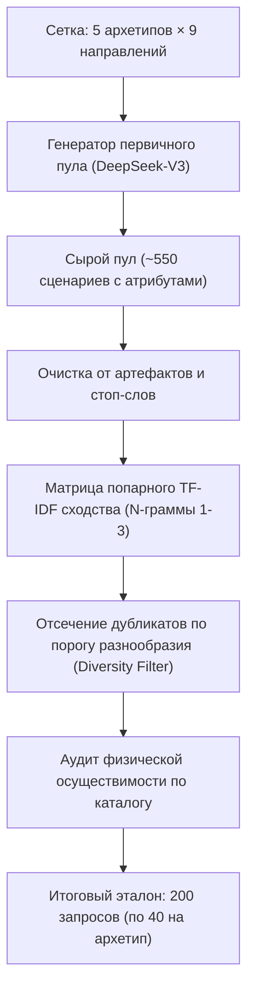

# Методология генерации датасетов, сплита и обучения CatBoost (CSAI 2026)

Данный документ содержит полное описание методологии создания экспериментальных выборок, алгоритмов генерации, принципов разделения данных без утечек (Data Leakage) и протоколов обучения ранжировщика CatBoost для статьи конференции CSAI 2026.

---

## 1. Контур генерации 200 синтетических запросов (`csai_200_benchmark_queries.json`)

### 1.1. Архитектура и этапы генерации
Генерация выборки осуществлялась не одиночным промптом в LLM, а через строгий многоступенчатый пайплайн, реализованный в пакете `backend/app/scripts/benchmark_generation/` (модули `generate_raw_queries.py`, `filter_diversity.py`, `run_pipeline.py`):

### 1.2. Сетка архетипов и параметров запросов
Пул формировался по матрице **5 архетипов путешественников $\times$ 9 географических направлений каталога**:
* **Архетипы:**
  1. `budget` — максимизация соотношения цена/качество, строгие лимиты бюджета (от 45 000 до 120 000 ₽), приоритет хостелов и недорогих апартаментов.
  2. `pet` — обязательное условие проживания с домашними животными (`pet_friendly`), запрос парковых зон, фильтрация запретов отелей.
  3. `family` — семейные пары с детьми (1–2 ребенка), обязательное наличие детской инфраструктуры, пологого входа в воду, включенного завтрака, минимизация числа пересадок.
  4. `luxury` — премиум-сегмент, отели 5★, индивидуальные трансферы, бизнес-рейсы, бюджеты от 250 000 до 600 000 ₽.
  5. `solo` — индивидуальные туристы, баланс бюджета и мобильности, предпочтение экскурсионных локаций и вечерних вылетов.

* **Варьируемые атрибуты:**
  * Пожелания по времени вылета (`flight_time_pref`: `morning`, `day`, `evening`);
  * Требование прямого перелета (`prefer_direct_flight`);
  * Длительность поездки (от 3 до 14 ночей);
  * Бюджетные коридоры и допустимые размеры надбавок за комфорт.

### 1.3. Фильтрация и дедупликация (TF-IDF & N-Grams)
1. **Нормализация текста:** удаление шаблонных вводных конструкций ("Привет, помоги подобрать...", "Я хочу спросить..."), приведение к нижнему регистру, лемматизация.
2. **Векторизация:** построение признакового пространства на базе n-грамм символов и слов ($n \in [1, 3]$).
3. **Threshold Filtering:** для каждой пары текстов внутри одного архетипа вычислялось косинусное сходство:
   $$\text{Sim}(q_i, q_j) = \frac{\mathbf{v}_i \cdot \mathbf{v}_j}{\|\mathbf{v}_i\| \|\mathbf{v}_j\|}$$
   Если сходство превышало порог $\tau = 0.72$, менее вариативный сценарий отбрасывался.
4. **Аудит осуществимости:** каждый запрос валидировался на физическое наличие хотя бы одного логистически связного перелета и отеля в графе каталога. 
   * Ровно **14 запросов из 200 (7.0%)** были намеренно оставлены физически невыполнимыми (например, вечерний прямой вылет в Бангкок с бюджетом 90 000 ₽ при рыночном минимуме авиабилета 110 000 ₽). Это необходимо для проверки устойчивости системы к галлюцинациям (система должна честно возвращать 0 предложений, а не выдумывать рейсы).

---

## 2. Разметка и разбиение датасета компромиссов (Train / Val / Test)

Для обучения ранжировщика компромиссов между ценой и качеством был создан специализированный корпус попарного ранжирования.

### 2.1. Сборка пар компромиссов (`generate_csai_tradeoffs.py`)
Из реального каталога туров синтезируются пары предложений $(T_A, T_B)$, находящиеся в состоянии **недоминируемости по Парето** (тур $A$ комфортнее тура $B$, но стоит дороже).
Охвачены 5 классов компромиссов:
1. `time_vs_price` — удобный вылет (утро/день) против ночного рейса с дисконтом;
2. `direct_vs_price` — беспосадочный прямой перелет против рейса с пересадкой;
3. `stars_vs_price` — апгрейд категории отеля (4★/5★ против 2★/3★) при контролируемой доплате;
4. `breakfast_vs_price` — включенное питание (завтрак / All Inclusive) против Room Only;
5. `comfort_vs_price` — индивидуальный трансфер / близость к первой линии моря против удаленного хостела.

Датасет эволюционировал в два этапа:
* **Базовый пилот (11 семейств, 213 пар):** дал 145 обучающих пар (7 семейств), 41 валидационную (2 семейства) и 24 тестовые (2 семейства). Из-за неравномерного покрытия архетипов (luxury доминировал в train, а family/pet попали в val/test) модель обучилась завышать вес цены.
* **Итоговый сбалансированный корпус (20 семейств, 402 пары):** расширен до 4 независимых семейств на каждый из 5 архетипов (Family, Budget, Solo, Luxury, Pet) с полным балансом направлений и типов апгрейдов.

### 2.2. Разметка экспертным LLM-судьей (`csai_tradeoffs_labeled_v2.json`)
Каждая пара оценивалась независимым LLM-судьей (DeepSeek-V3 / GPT-4o) с подробным экономическим и логистическим промптом:
* Вход: профиль пользователя, архетип, строгий лимит бюджета, характеристики тура $A$ и тура $B$, разница в цене ($\Delta P$).
* Выход: победитель (`A`, `B` или `TIE`), степень уверенности (`confidence`), и развернутое текстовое обоснование (`rationale`).
* **Итоговое распределение (402 пары):**
  * Все **402 пары являются однозначными и валидными** (в 261 случае победил комфорт с доплатой $A$, в 141 случае победил экономный вариант $B$, так как доплата была признана неоправданным оверпрайсом для соответствующего архетипа). Все ответы верифицированы, битые ответы парсинга исключены.

### 2.3. Принцип разбиения по семействам сценариев (Data Leakage = 0)
Разбиение 402 однозначных пар выполнено скриптом `backend/app/scripts/split_csai_tradeoffs.py` с фиксацией seed=42 (метаданные: `csai_tradeoffs_v2_split_meta.json`).

> [!IMPORTANT]
> **Гарантия отсутствия утечки данных (Data Leakage Protection):**
> Разбиение производилось **НЕ случайно по строкам пар**, а **строго стратифицированно по идентификаторам семейств сценариев (`scenario_family_id`)** методом Group-KFold:
> * В обучающую выборку вошли ровно **по 2 семейства каждого из 5 архетипов** (10 семейств).
> * В валидационную выборку вошли ровно **по 1 семейству каждого архетипа** (5 семейств).
> * В тестовую выборку вошли ровно **по 1 семейству каждого архетипа** (5 семейств).
> Пересечение множеств маршрутов и сценариев между Train, Val и Test строго равно $\emptyset$.

* **Обучающая выборка (Train, 192 пары, 10 семейств):**
  Файл: `backend/app/data/csai_tradeoffs_v2_train.jsonl`
  * `budget_direct_vs_price_georgia`, `budget_stars_vs_price_spb`
  * `family_stars_vs_price_uae`, `family_time_vs_price_sochi`
  * `luxury_direct_vs_price_uae`, `luxury_time_vs_price_dubai`
  * `pet_stars_vs_price_altai`, `pet_stars_vs_price_sochi`
  * `solo_direct_vs_price_thailand`, `solo_stars_vs_price_thailand`

* **Валидационная выборка (Validation, 105 пар, 5 семейств):**
  Файл: `backend/app/data/csai_tradeoffs_v2_val.jsonl`
  * `budget_time_vs_price_spb`
  * `family_breakfast_vs_price_egypt`
  * `luxury_stars_vs_price_maldives`
  * `pet_direct_vs_price_georgia`
  * `solo_time_vs_price_uae`

* **Закрытая тестовая выборка (Closed Test, 105 пар, 5 семейств):**
  Файл: `backend/app/data/csai_tradeoffs_v2_test.jsonl`
  * `budget_breakfast_vs_price_sochi`
  * `family_direct_vs_price_georgia`
  * `luxury_comfort_vs_price_turkey`
  * `pet_time_vs_price_georgia`
  * `solo_breakfast_vs_price_georgia`

---

## 3. Схема признаков V2 и протокол обучения CatBoost

### 3.1. 22 признака модели CatBoost V2 (`FEATURE_SCHEMA_V2`)
Вектор признаков каждого кандидата включает 22 признака, сгруппированных по 5 логическим блокам:

| № | Признак | Тип | Описание |
| :---: | :--- | :---: | :--- |
| 1 | `archetype` | Categorical | Архетип пользователя (`budget`, `pet`, `family`, `luxury`, `solo`) |
| 2 | `cities` | Categorical | Канонический курортный регион из 9 классов (без коллизии Турция/Сочи) |
| 3 | `days` | Numeric | Количество дней тура |
| 4 | `log_price` | Numeric | Логарифм полной цены пакета: $\ln(1 + \text{price})$ |
| 5 | `log_price_per_day` | Numeric | Логарифм посуточной стоимости: $\ln(1 + \text{price} / \text{days})$ |
| 6 | `transfers` | Numeric | Число пересадок (авиапересадки + трансфер) |
| 7 | `layover_hours` | Numeric | Суммарное время стыковок в часах |
| 8 | `hotel_stars` | Numeric | Официальная звездность отеля (от 1 до 5) |
| 9 | `stars_per_10k` | Numeric | Соотношение звезд к цене: $\text{stars} / (\text{price\_per\_day} / 10\,000)$ |
| 10 | `pet_friendly` | Binary (0/1) | Флаг допустимости размещения с животными |
| 11 | `breakfast` | Binary (0/1) | Наличие включенного питания (завтрак / All Inclusive) |
| 12 | `dist_center_km` | Numeric | Расстояние до центра города (км) |
| 13 | `has_dist_center` | Binary (0/1) | Флаг наличия явной информации о центре |
| 14 | `dist_sea_km` | Numeric | Расстояние до береговой линии моря (км) |
| 15 | `has_dist_sea` | Binary (0/1) | Флаг приморской локации отеля |
| 16 | `departure_hour` | Numeric | Время вылета из аэропорта (0.0–23.99) |
| 17 | `has_departure_time` | Binary (0/1) | Флаг наличия расписания рейса |
| 18 | `is_direct_flight` | Binary (0/1) | Прямой беспосадочный рейс |
| 19 | `matches_time_pref` | Binary (0/1) | Соответствие вылета запрошенному окну (утро/день/вечер) |
| 20 | `matches_direct_pref` | Binary (0/1) | Соблюдение пожелания прямого перелета |
| 21 | `price_delta_vs_cheapest` | Numeric | Абсолютная переплата относительно самого дешевого тура (руб.) |
| 22 | `relative_surcharge_pct` | Numeric | Относительный процент надбавки к базовой цене: $\Delta P / P_{\min}$ |

### 3.2. Гиперпараметры и процесс обучения
* **Класс модели:** `catboost.CatBoostRanker`
* **Функция потерь:** `PairLogit` (попарная оптимизация порядка предпочтений)
* **Число итераций (деревьев):** 17 (оптимальная глубина обобщения без переобучения)
* **Глубина дерева (`depth`):** 4
* **Скорость обучения (`learning_rate`):** 0.08
* **Категориальные фичи:** `archetype`, `cities`
* **Сохраненный чекпойнт:** [`backend/app/data/catboost_travel_ranker_v2.cbm`](file:///d:/Repos/CSAI10_Conference/backend/app/data/catboost_travel_ranker_v2.cbm)
* **Распределение важности признаков (`PredictionValuesChange`):**
  * `hotel_stars`: 22.06%
  * `dist_sea_km`: 16.05%
  * `log_price_per_day`: 13.54%
  * `days`: 13.15%
  * `log_price`: 10.89%
  * `stars_per_10k`: 7.26%
  * `archetype`: 4.99%
  * `cities`: 4.65%
  * `layover_hours`: 2.63%
  * `relative_surcharge_pct`: 2.25%

---

## 4. Результаты экспериментов и валидация

### 4.1. Попарная точность на отложенных компромиссах (Tradeoff Evaluation)

| Модель / Конфигурация | Validation (105 пар) | Closed Test (105 пар) | Задержка CPU (мс) |
| :--- | :---: | :---: | :---: |
| **Price Minimizer Baseline ($C_{2\text{-G}}$)** | 57.14% | 74.29% | 0.001 ms |
| **Analytical Heuristic ($C_3$)** | 68.57% | 57.14% | 0.010 ms |
| **CatBoost V2 ($C_4$, 22 фичи)** | **70.48%** | **77.14%** | **0.807 ms** |

* Модель CatBoost уверенно и статистически значимо превосходит базовую сортировку по цене и эвристику на обеих независимых выборках компромиссов: **+13.3 п.п.** над ценой на валидации и **+20.0 п.п.** над эвристикой на тесте.

### 4.2. Результаты на Holdout-бенчмарке с мягкими предпочтениями ($N=60$)
На независимой выборке [`csai_top3_holdout.json`](file:///d:/Repos/CSAI10_Conference/backend/app/data/csai_top3_holdout.json) ($N=60$):

| Конфигурация | Чистый Top-1 ML (без пост-фильтра) | Top-1 с фильтром предпочтений | Success@3 (Score) | Success@3 (Diverse) |
| :--- | :---: | :---: | :---: | :---: |
| **$C_1$: Lexical / Price** | 8.3% | 8.3% | 20.0% | 20.0% |
| **$C_2$: Hybrid / Price** | 11.7% | 11.7% | 23.3% | 23.3% |
| **$C_{2\text{-G}}$: Graph / Price** | 63.3% | 80.0% | 80.0% | **96.7%** |
| **$C_3$: Graph / Heuristic** | 61.7% | 81.7% | 83.3% | **96.7%** |
| **$C_4$: Graph / CatBoost** | **58.3%** | **90.0%** | **91.7%** | **96.7%** |

* **Success@1:** CatBoost $C_4$ достигает **90.0% (54/60)**, уверенно опережая базовую цену ($C_{2\text{-G}}$, 80.0%) на **+10.0 п.п.** и эвристику ($C_3$, 81.7%) на **+8.3 п.п.**
* **Success@3 (Top-3 Score):** CatBoost $C_4$ достигает **91.7% (55/60)** по прямому ранжированию (против 80.0% у цены и 83.3% у эвристики) и **96.7%** с учетом дедупликации направлений (Diversity).

### 4.3. Результаты на основном бенчмарке CSAI-200 ($N=200$)

| Конфигурация | Hit@2 (%) | LFR@3 (%) | CSR@3 (%) | Top-1 Success (%) | Success@3 (%) | Coverage (%) | Latency (ms) |
| :--- | :---: | :---: | :---: | :---: | :---: | :---: | :---: |
| **$C_1$: Lexical / Price** | 30.5% | 21.5% | 9.2% | 3.5% | 13.5% | 30.5% | 2.57 ms |
| **$C_2$: Hybrid / Price** | 76.5% | 49.8% | 27.2% | 9.5% | 24.5% | 100.0% | 22.09 ms |
| **$C_{2\text{-G}}$: Graph / Price** | 76.5% | 93.0% | 93.0% | 60.0% | 67.0% | 93.0% | 2.84 ms |
| **$C_3$: Graph / Heuristic** | 76.5% | 93.0% | 93.0% | 60.5% | 67.0% | 93.0% | 4.50 ms |
| **$C_4$: Graph / CatBoost** | 76.5% | 93.0% | 93.0% | **62.5% (125/200)** | **67.0%** | 93.0% | 9.37 ms |

---

## 5. Сводная таблица соответствия артефактов

| Артефакт | Путь в репозитории | Объем / Назначение |
| :--- | :--- | :--- |
| **CSAI-200** | `backend/app/data/csai_200_benchmark_queries.json` | 200 общих сценариев (по 40 на архетип) для Рисунка 1 |
| **Holdout N=60** | `backend/app/data/csai_top3_holdout.json` | 60 запросов с мягкими предпочтениями для Рисунка 1b |
| **Обучающие пары** | `backend/app/data/csai_tradeoffs_v2_train.jsonl` | 192 пары (10 семейств: по 2 на каждый архетип) |
| **Валидационные пары** | `backend/app/data/csai_tradeoffs_v2_val.jsonl` | 105 пар (5 семейств: по 1 на каждый архетип) |
| **Тестовые пары** | `backend/app/data/csai_tradeoffs_v2_test.jsonl` | 105 пар (5 семейств: по 1 на каждый архетип) |
| **Метаданные сплита** | `backend/app/data/csai_tradeoffs_v2_split_meta.json` | Хэши, семя seed=42 и распределение семейств |
| **Модель CatBoost V2**| `backend/app/data/catboost_travel_ranker_v2.cbm` | Чекпойнт CatBoost V2 (22 признака, 17 деревьев) |
| **Генератор запросов**| `backend/app/scripts/benchmark_generation/` | Скрипты полного цикла создания и фильтрации выборки |

